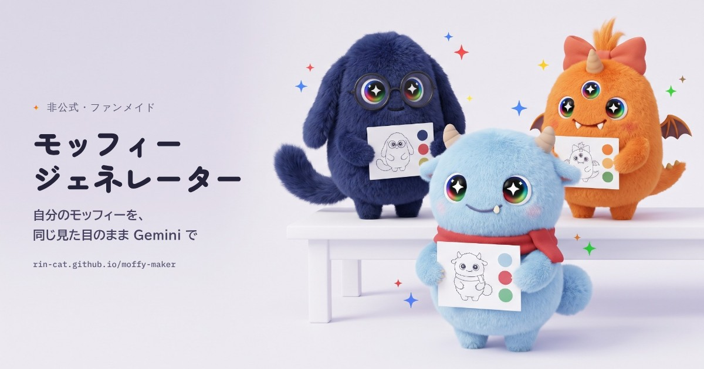

# 非公式モッフィージェネレーター



Gemini から生まれたキャラクター「モッフィー」を、**同じ見た目のまま**いろいろな場面で遊ばせる、非公式のファンメイドツールです。Gemini の Canvas 版は画像までその画面で生成でき、Web 版（GitHub Pages）は、自分の Gemini アプリに貼る指示書（プロンプト）を作ります。
Google AI 学生コミュニティ（Google AI 学生アンバサダープログラムから続く学生コミュニティ）の仲間と一緒に遊んだり、Nano Banana のプロンプトの書き方を学んだりすることを想定して作りました。

- **使ってみる（Web 版）**：https://rin-cat.github.io/moffy-maker/
- **Canvas 版**：Gemini の Canvas に入れて使います（下の「Gemini の Canvas で使う」）
- **無料・API キー不要**：画像は自分の Gemini（Canvas かアプリ）で作ります
- **非公式**：Google とは関係のないファンメイドです

## こんな人に

- 公式のモッフィージェネレーターで作った子を、おでかけ・スタンプ・フィギュアなど、もっといろんな場面で遊ばせたい
- 作り直すたびに見た目が変わってしまうのを減らしたい
- Nano Banana（Gemini の画像生成）のプロンプトの書き方を、実例と根拠つきで学びたい
- 勉強会や Discord で、みんなのモッフィーを集めて共演させたい

## 3ステップで使う

1. **モッフィーを決める**：好きな言葉とパーツを選ぶ（見本とガチャもあります）。目の見本は最初から入っています（Gemini で作ったモッフィーの目を切り抜いた標準の目。自分の子の目のアップに差しかえも可）
2. **基準画像をつくる**：目の見本を Gemini に添付し、レシピ「基準画像をつくる」の指示書を貼って送る。出てきた画像を保存する（これが以後の見本になります）
3. **遊ぶ**：レシピを選び、指示書に書かれた順番で目の見本と基準画像を添付して、指示書を貼る（Gemini のモデルは Flash か Pro）

Gemini とのやりとりは、指示書を貼るたびに1回で画像が出ます。返事を取り込み直す必要はありません。

- 公式ジェネレーターなどで、すでに画像がある子を遊ばせたいときは、先にレシピ「公式の子を取り込む」でその子の全身の画像から特徴を読み取り、返ってきた JSON を「取り込む」に貼ります
- 「文章だけ」で使う人や、DNA コードを友だちに渡す人は、「基準画像をつくる」で「決まった見た目を文字でも受け取る」を選ぶと、おまかせだった所を DNA に取り込めます

レシピは16種類あります：基準画像／設定画（任意）／公式の子を取り込む／おでかけ／着せ替え／ぷくぷくシール／フィギュア／SNS アイコン／スタンプ（4・6・8コマ）／季節イベント／4コマまんが／友だちと共演（最大4匹）／自分の写真に連れていく／ルールチェック／部分修正／Gem にする

## キラキラの目を出すしくみ

公式ジェネレーターの目がキラキラなのは、強いモデルを使っているからではなく、次の4つの組み合わせです。このツールでも同じ形にそろえました。

| 公式ジェネレーター | このツール |
|---|---|
| 目の見本画像を毎回いっしょに渡す | 標準の目の見本（Gemini で作ったモッフィーの目を切り抜いたもの）を最初から用意し、指示書に添付の順番（目の見本はいつも1枚目）と「目の描き方だけをまねる」指示を入れる。画像はコピー・保存・共有ができ、添付の一覧からもコピーできる。自分の画像に差しかえることもできる（白い正方形に整え、拡大・ずらしも可） |
| 鼻・目・頭身などの絶対ルールを、システム指示として最初に渡す | 指示書の先頭に「絶対に守るルール」を短くまとめる。Gem にすると、カスタム指示がシステム指示の代わりになる |
| 最初の1枚は1体・真正面・左右対称・白い背景・正方形 | レシピ「基準画像をつくる」が同じ構図。以後はこの画像を基準画像として添付する |
| 生成後にルールを確かめ、黒いだけの目などは不合格にして作り直す | レシピ「ルールチェック」で理由つきの判定と、直すための指示文を返してもらい、「部分修正」で直す |


標準の目の見本は、作者が Gemini で作ったモッフィーの画像から右目を切り抜き、毛がかかっていた所を白目の陰影でうめたものです（`tools/make_eye.py`）。公式ジェネレーターの見本画像は使っていません。画像ファイルは [docs/eye-sample.png](docs/eye-sample.png)（クラシック版は [docs/eye-sample-classic.png](docs/eye-sample-classic.png)）からも保存でき、Gem の「知識」に入れておくこともできます。自分の画像に差しかえたときも、画像はブラウザの中だけで扱います（どこにも送信しません）。

## Gemini の Canvas で使う（Canvas 版）

[`canvas/moffy-canvas.html`](canvas/moffy-canvas.html) は、Gemini の Canvas に貼って使う1ファイル版です。機能は GitHub 版とすべて同じで、さらに Canvas の中では次のことができます。

- 「このページで生成」を押すと、画像まで作れる（目の見本・基準画像・写真などを、指示書の順番で自動で添付）
- 生成した画像を、そのまま基準画像にしたり、部分修正・ルールチェックに回したりできる
- 「公式の子を取り込む」の返事はボタンで DNA に取り込め、「ルールチェック」の結果からは、そのまま直せる

生成には、使う人それぞれの Gemini の利用枠を使います（API キーは不要。公式ジェネレーターと同じ呼び方です）。うまく生成できないときは、今までどおり「指示書をコピー」して Gemini アプリで作れます。

### Canvas に入れる手順

Gemini に「このファイルを Canvas に移して」と頼むと、Gemini が長いコードを全部書き直すことになり、「お役に立てません」と断られたり、途中で崩れたりします。次のどちらかの方法で入れてください。

**方法A：コードをそのまま貼る（いちばん確実）**

1. パソコンで [gemini.google.com](https://gemini.google.com/app) を開き、入力欄の「ツール」から「Canvas」を選んで「『テスト』とだけ表示する HTML を作って」と送る
2. 右に Canvas が開いたら、右上の「コード」を開き、コードの欄で全選択（Ctrl+A／⌘A）して消す
3. [moffy-canvas.html の中身（raw）](https://raw.githubusercontent.com/Rin-cat/moffy-maker/main/canvas/moffy-canvas.html)を開いて全選択・コピーし、コードの欄に貼る
4. プレビューに戻り、「基準画像をつくる」→「このページで生成」で画像が出るか確かめる
5. 右上の「共有」からリンクを作って配る（貼ったあとは、Gemini に Canvas の修正を頼まないでください。作り直されて崩れます）

**方法B：読み込み版（短いコードで、本体を GitHub Pages から読む）**

[`canvas/loader.html`](canvas/loader.html) は20行ほどのコードで、本体（https://rin-cat.github.io/moffy-maker/canvas.html）を読み込んで表示します。短いので Gemini に「このコードをそのまま Canvas にして」と頼んでも通りやすく、方法A の 2〜3 でこのコードを貼ってもかまいません。本体を直すと、Canvas 側も自動で新しくなります。ただし、GitHub Pages が開けないときは動きません。

- Canvas の中では、画像の保存やコピーができないことがあります。そのときは画像を長押し（右クリック）して保存してください
- 共有リンクと QR コードは、GitHub Pages の版を開きます
- ツールを直したら、`python3 tools/build_canvas.py` で作り直します（方法A は Canvas のコードを貼り替え、方法B はそのままで反映されます）

## その子らしさを出す3つのしかけ

同じルールから生まれるモッフィーは、そのままだと「かわいい・ふわふわ」に寄って似てきます。このツールでは、次の3つで個性を残します。

- **言葉 → モチーフ**：「登山が好き」を「小さなリュック・コンパス・ほっぺの日焼け」のような目に見えるものに置きかえて固定します。「言葉から提案」で約50語の辞書から候補を出し、辞書にない言葉は、基準画像のときに Gemini が考えて描きます。らしさの強さ（ひかえめ／ふつう／つよめ）も選べます
- **プロフィール帳**：口ぐせ・クセ・好きなもの・苦手なもの・夢。公式のモッフィーの「感情が動くとしっぽが震える」のように、クセはしぐさに、口ぐせは4コマやスタンプのセリフに、好き・苦手はお話に使われます
- **自分の写真に連れていく**：自分で撮った景色の写真を背景にします。背景が自分だけのものなので、仕上がりが人と被りません（人や個人情報が写っていない写真を使ってください）

## コミュニティで遊ぶ

### DNA コードを交換して共演する

DNA カードの「QR コード」をスマホで読み合うか、DNA コード（`MF1.` で始まる文字）を Discord に貼って交換します。友だちのコードをレシピ「友だちと共演」に貼ると、最大4匹が並ぶ画像の指示書になります。
SNS に投稿するときは、公式 note にならって `#モッフィー` `#GoogleGemini` をつけるのがおすすめです。

### 勉強会での使い方（15分の例）

| 時間 | やること |
|---|---|
| 3分 | 見本かガチャで、自分のモッフィーの DNA を決める |
| 5分 | 「基準画像をつくる」を、目の見本と一緒に Gemini で試す |
| 5分 | 隣の人と QR を交換し、「友だちと共演」で集合写真を作る |
| 2分 | 解説モードを開き、「なぜこう書くのか」を読み合う |

### 発表デモの流れ（5分の例）

1. 課題：公式ジェネレーターは楽しいけれど、作り直すたびに見た目が変わる（体験記では、理想の子まで約6回の再生成）
2. 解決：公式ジェネレーターと同じしくみ（目の見本・先頭のルール・正面の基準画像・生成後のチェック）を、API なしの指示書で再現する
3. デモ：ガチャ → 基準画像（目の見本を添付）→ おでかけ → ルールチェック
4. 学び：解説モードで、公式ガイドのコツがどこに効いているかを見せる
5. 交換：会場で QR を読み合う

## 学べるプロンプトのコツ

解説モードをオンにすると、指示書の各ブロックに「なぜこう書くのか」と根拠が表示されます。

| コツ | このツールでの使い方 | 根拠（公式ガイド） |
|---|---|---|
| 具体的に描写する | 見た目をキーワードではなく文章で書く | Be Hyper-Specific |
| 言葉を目に見えるものにする | 「登山が好き」をリュック・コンパスなどのモチーフに置きかえる | Be Hyper-Specific |
| 用途と意図を伝える | 指示書の最初に「何に使う画像か」を書く | Provide Context and Intent |
| 否定より、望む状態を書く | 「鼻を描かない」に加えて「目と口のあいだは毛並みが続く」と書く | Semantic Negative Prompts |
| 手順に分ける | おでかけは「背景 → モッフィー → なじませる」の順に頼む | Use Step-by-Step Instructions |
| 縦横比を毎回書く | 添付した画像の縦横比に引きずられるのを防ぐ | Aspect ratios and image size |
| 細部は見本画像で伝える | 目の見本を添付し、「目だけをまねる」と頼む | 公式ジェネレーターの作り方 |
| 添付した画像の役割を最初に書く | 「1枚目：目の見本（キャラクターではない）」「2枚目：基準画像」のように、何枚目が何かを先頭に書く | Provide Context and Intent |
| ルールは先頭に短く | 「絶対に守るルール」を最初に置き、場面の説明に埋もれさせない | 公式ジェネレーターの作り方 |
| 描かせたくない物の名前を書かない | 「黒目」と書かず「虹色の輪」「大きな白い四芒星」のように描いてほしい形を書く。表情名をかぎかっこで書かない（文字ラベルになる） | Semantic Negative Prompts |
| 文字は先に確定する | スタンプの言葉を先に列挙してから描かせる | Limitations |
| その部分だけ直す | 作り直さず「◯◯だけ直して、ほかは同じに」と頼む | Inpainting (Semantic masking) |

出典：[Nano Banana image generation（Google AI for Developers）](https://ai.google.dev/gemini-api/docs/image-generation)、公式ジェネレーター（Gemini の Canvas アプリ）の作り。調査の詳細は [research-notes.md](research-notes.md) にまとめています。

## 使うときの約束

- 基準画像や目の見本を添付して作るのは、Gemini アプリでは「画像の編集」にあたり、**18歳以上**が対象です。18歳未満の人は「文章だけ」モードを使ってください
- 「自分の写真に連れていく」では、人や個人情報（表札・住所・車のナンバーなど）が写っていない写真を使ってください
- 既存のキャラクターや実在の人物に似せる使い方はしないでください（既存キャラクター名は指示書から自動で外しますが、網羅ではありません）
- 公式 note の「マナーを守って楽しく遊ぼう」と、Google の生成 AI のポリシーにならってください
- 無料版の1日の生成数には上限があります。気になる所は「部分修正」で直すと節約できます

## フィードバック募集

[Issues](https://github.com/Rin-cat/moffy-maker/issues) で気軽に教えてください。

- 試してうまくいった／いかなかった指示書（レシピ名、添付ありか文章だけか、Gemini のモデル）
- 新しいレシピや見本のアイデア
- 表示の崩れや、使いにくい所

画像を貼るときは、個人情報や他人の写真が写っていないか確認してください。

## 公式ジェネレーターとの役割分担

| 場面 | 公式モッフィージェネレーター | このツール |
|---|---|---|
| 生む | 言葉とタグから画像と性格を生成。ルールの自動チェックつき | 公式の子を取り込むか、パーツを指定して言葉から作る |
| 固定する | 画像を保存 | 基準画像・設定画、目の見本、DNA コード、QR コード |
| 遊ぶ | 着せ替え・おでかけ・ぷくぷくシール | 左の3つに加え、フィギュア・アイコン・スタンプ・季節・4コマ・共演 |
| 直す | 要望を書き足して再生成 | 理由つきのルールチェックと、その部分だけを直す部分修正 |

## 開発者向け

HTML ファイル1つで動く静的サイトです。ビルドの道具やサーバーはいりません。

```
moffy-studio.html      ツール本体（ここを編集する）
docs/                  GitHub Pages で公開している版（tools/build.py で生成）
canvas/moffy-canvas.html  Gemini の Canvas に貼る1ファイル版（tools/build_canvas.py で生成。画面の中で画像まで生成できる）
canvas/loader.html     Canvas の読み込み版（本体 docs/canvas.html を GitHub Pages から読む）
  index.html             完全な HTML（lang、OG タグ、ファビコンつき）
  og.jpg                 リンクを貼ったときのプレビュー画像（1200×630）
  social-preview.jpg     GitHub の Social preview 用（1280×640）
  eye-sample.png         標準の目の見本（768×768。クラシック版は eye-sample-classic.png）
assets/og-base.jpg     サムネイルの絵（Gemini で生成した文字なしの絵）
assets/hero.jpg        ページ上部の絵（og-base.jpg から3匹の部分を切り出したもの）
assets/eye-sample.png  標準の目の見本のもと（tools/make_eye.py で作り、ツールに埋めこむ）
gem-instructions.md    Gem「モッフィー工房」に貼る文章
research-notes.md      調査メモ（出典つき）
tools/build.py         docs/index.html を作る
tools/build_canvas.py  Gemini の Canvas に貼る1ファイル版（canvas/moffy-canvas.html）を作る
tools/assets.js        サムネイル2種（絵に文字を重ねる）、標準の目の見本（docs/ 用）、gem-instructions.md を作る
tools/make_eye.py      Gemini で作ったモッフィーの画像から、標準の目の見本を切り抜いてツールに埋めこむ（もとの画像は同梱しない）
tests/                 自動テスト
.claude/skills/frontend-design/  デザイン調整用スキル（Anthropic 製。anthropics/skills から未改変で同梱、Apache 2.0）
.claude/skills/web-design-guidelines/  UI レビュー用スキル（Vercel 製。vercel-labs/agent-skills から未改変で同梱、MIT）
```

`moffy-studio.html` を編集したら、公開用を作り直します。

```bash
python3 tools/build.py https://rin-cat.github.io/moffy-maker/
```

```bash
python3 tools/build_canvas.py
```

```bash
node tools/assets.js
```

テストは Playwright（Chromium）で動きます。引数を省くと `moffy-studio.html` を、`docs/index.html` を渡すと公開用を検査します。

```bash
node tests/smoke.js      # 機能テスト（全レシピ、DNA の往復、取り込み、QR、360〜768px の横スクロール、標準の目の見本・差しかえ・貼り付け・保存・添付の説明など 89 項目）
node tests/lint.js       # 指示書の点検（ガチャ DNA × 全レシピ × 添付あり/なし × 目の見本あり/なし、約4,400通り）
node tests/a11y.js       # axe-core によるアクセシビリティ検査（ライト／ダーク）
node tests/link.js       # 共有リンクと QR（公開 URL を入れて build したとき）
node tests/canvas.js     # Canvas 版（Gemini API の返事をまねて、添付の順番・縦横比・再試行・取り込み・直しの流れなど 30 項目）
node tests/loader.js     # Canvas の読み込み版（本体を読み込んで生成まで動くか）
```

## 改善の記録

| 回 | 調べたこと | 作ったこと・直したこと |
|---|---|---|
| 1 | 2025年版の本家プロンプト全文、2026年の公式 note、体験記、Nano Banana 公式ガイド、Gemini アプリと Gem の仕様 | 指示書の全面作り直し、解説モード、DNA コードと QR、14レシピ、取り込み、Gem 書き出し、2つのモード |
| 2 | 類似ツールの使い勝手、スマホでの受け渡し（共有メニューは主に画像のみ）、axe-core による検査 | 見本とガチャ、レシピごとの「このあと」、貼り方の案内、DNA の共有メニュー、アクセシビリティ違反 0、プレビューのはみ出し修正 |
| 3 | 約1,500通りの自動点検、Gemini の返事によくある崩れた JSON | 文字を入れない指定の追加（990件の抜けを解消）、ゆるい JSON の取り込み、GitHub Pages 用の構成と OG 画像 |
| 4 | オリジナリティの不足（言葉が「かわいい」に埋もれる、中身の設定が性格1行だけ、全員が同じ背景になる） | 言葉→モチーフの辞書と強さの指定、プロフィール帳（口ぐせ・クセ・好き・苦手・夢）、自分の写真に連れていくレシピ。背景がある場面に残っていた「スタジオライト」との光の矛盾を直し、自動点検に追加 |
| 5 | スキル frontend-design（見た目の方針）と web-design-guidelines（Vercel の UI 規則 約100項目）で全体を点検 | UI を全面的に作り直し。アニメ制作の「設定資料」をモチーフに、青鉛筆＝描く・選ぶ、赤鉛筆＝直す・解説と色の役割を決め、キャラ表（ラフの線画・色指定・パーツ表）を入力の横に追従させた。解説は指示書の余白に赤ペンの手書きで表示。入力欄の name・autocomplete、入力例の「…」、画像の寸法、テーマ色、自動翻訳の対象外指定などを規則どおりに整えた |
| 6 | 公式ジェネレーターの作り（目の見本画像・先頭のシステム指示・正面1:1の構図・生成後のチェックの4つが、キラキラの目を支えている）と、Gemini で作った設定画の失敗例（鼻・黒い瞳孔・文字ラベル・頭身） | 最初の1枚を「基準画像」（1体・真正面・白背景・1:1）に変更。目の見本をページに添付・貼り付けで入れられるようにし（ブラウザ内だけで処理）、指示書に添付の順番を自動で入れる。絶対ルールを先頭に短くまとめ、頭身のルールを追加。「黒目」という言葉をやめ、黒い瞳孔をルールチェックで不合格に。設定画は文字ラベルが出ない書き方に。体のかたち5種とツノ5種を追加し、ラフの目を公式に近い形に |
| 7 | 目の見本を各自で用意するのは手間で、用意できない人は目の見本なしで作ることになる | 公式のルールどおりの目をツールが描き、最初から目の見本に入れて指示書に組み込んだ（公式の見本画像は使わない）。添付の一覧からコピー・保存、スマホは共有メニューへ。Gem には「知識」への追加を案内。docs/eye-sample.png としても配布 |
| 8 | 作者が Gemini で作ったレインボーのモッフィーで、本物の目の作りを確認（つやのある白い目玉・虹色の輪・内側ほど深い色・大きな白い四芒星・左上の四角いツヤ・右下の小さな丸いツヤ） | 標準の目の見本を、その画像から切り抜いた本物の目に変更（毛がかかった所は白目の陰影でうめ、クラシックは虹彩の色だけ置きかえ）。目の説明とルールチェックを本物の目に合わせ、「瞳孔は見えない・黒い瞳孔を描かない」を「黒いだけの目や点の目にしない」に直した。ラフの目にも四角いツヤと丸いツヤを入れた |
| 9 | 試したところ、「公式の子を取り込む」に目の見本を添付してしまい、目そのものを1匹のキャラクターとして読んだ JSON（毛なし・丸い球体・目は1つ）が返ってきた | 指示書の先頭に「添付した画像」（何枚目が何か。目の見本はキャラクターではない）を入れた。取り込みは、目だけの画像なら JSON を書かずに知らせる。目の見本の欄に、いまのレシピで添付するか（何枚目か）を出し、添付しないレシピでは薄く表示 |
| 10 | 「要素を選ぶ → JSON → 取り込み直す → 画像」の二度手間に見える（基準画像の返事に JSON があり、取り込みが必須の手順のように案内していた） | 基準画像は画像だけを返すのを既定にし、JSON は「決まった見た目を文字でも受け取る」を選んだときだけに。案内と README から、JSON の取り込みを必須に見せる書き方を外した。取り込みのレシピは、すでに画像がある子専用と明記 |
| 11 | Gemini の Canvas アプリ（公式ジェネレーターと同じ）は、API キーなしで画像モデルを呼べる | 全機能をそのまま Canvas 用の1ファイルに書き出し、画面の中で画像まで生成できるようにした（目の見本・基準画像などは指示書の順番で自動添付、結果から基準画像・部分修正・ルールチェックへ、取り込み・直しもボタンで）。指示書のコピーも残した |
| 12 | Canvas 版で画像まで作れるようになり、「指示書メーカー」という名前が中身と合わなくなった | 名前を「非公式モッフィージェネレーター」に統一（ページのタイトル・見出し・説明、OG 画像とタグ、README、Canvas 版）。見出しの「非公式」のはんこは見た目だけにして、見出しの文字と読み上げは「非公式モッフィージェネレーター」になるようにした |

## 免責

- 非公式のファンメイドツールです。内容は作者個人によるもので、Google の公式な製品や見解ではありません。モッフィーは Google のキャラクターです
- サムネイルの絵は、このツールの見本3匹を Gemini（Nano Banana）で生成し、鼻の修正と文字入れをあとから行ったものです
- 公式ジェネレーターの目の見本画像やシステム指示は、このリポジトリに含めていません。しくみを要約して参考にしています
- 公式のモッフィージェネレーター：[goo.gle/moffy-generator](https://goo.gle/moffy-generator)／公式ガイド：[Gemini でつくれるキャラクター「モッフィー」のすべて](https://note.com/google_gemini/n/n4bc7c828daff)
- ライセンスは未設定です
