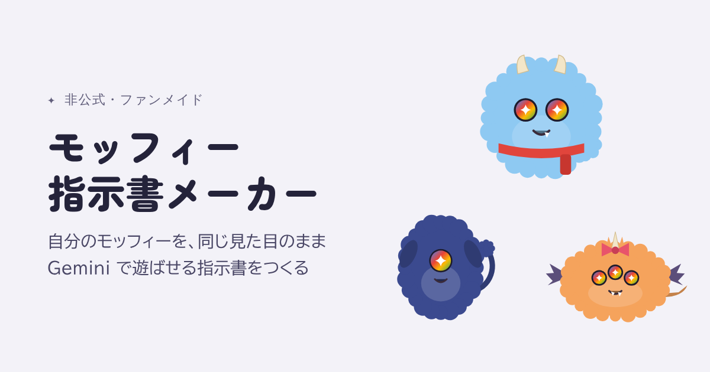

# モッフィー指示書メーカー（非公式）



Gemini から生まれたキャラクター「モッフィー」を、**同じ見た目のまま**いろいろな場面で遊ばせるための指示書（プロンプト）を作る Web ツールです。
Google AI 学生コミュニティ（Google AI 学生アンバサダープログラムから続く学生コミュニティ）の仲間と一緒に遊んだり、Nano Banana のプロンプトの書き方を学んだりすることを想定して作りました。

- **使ってみる**：https://rin-cat.github.io/moffy-maker/
- **無料・API キー不要**：画像は自分の Gemini アプリで作ります
- **非公式**：Google とは関係のないファンメイドです

## こんな人に

- 公式のモッフィージェネレーターで作った子を、おでかけ・スタンプ・フィギュアなど、もっといろんな場面で遊ばせたい
- 作り直すたびに見た目が変わってしまうのを減らしたい
- Nano Banana（Gemini の画像生成）のプロンプトの書き方を、実例と根拠つきで学びたい
- 勉強会や Discord で、みんなのモッフィーを集めて共演させたい

## 3ステップで使う

1. **モッフィーを決める**：好きな言葉とパーツを選ぶ（見本とガチャもあります）。公式ジェネレーターで作った子は「取り込む」から
2. **設定画をつくる**：レシピ「設定画をつくる」をコピーして Gemini に貼る。出てきた設定画を保存し、一緒に返ってくる JSON を「取り込む」に貼る
3. **遊ぶ**：レシピを選び、設定画を添付して指示書を貼る（Gemini のモデルは Flash か Pro）

レシピは14種類あります：設定画／公式の子を取り込む／おでかけ／着せ替え／ぷくぷくシール／フィギュア／SNS アイコン／スタンプ（4・6・8コマ）／季節イベント／4コマまんが／友だちと共演（最大4匹）／ルールチェック／部分修正／Gem にする

## コミュニティで遊ぶ

### DNA コードを交換して共演する

DNA カードの「QR コード」をスマホで読み合うか、DNA コード（`MF1.` で始まる文字）を Discord に貼って交換します。友だちのコードをレシピ「友だちと共演」に貼ると、最大4匹が並ぶ画像の指示書になります。
SNS に投稿するときは、公式 note にならって `#モッフィー` `#GoogleGemini` をつけるのがおすすめです。

### 勉強会での使い方（15分の例）

| 時間 | やること |
|---|---|
| 3分 | 見本かガチャで、自分のモッフィーの DNA を決める |
| 5分 | 「設定画をつくる」を Gemini で試す |
| 5分 | 隣の人と QR を交換し、「友だちと共演」で集合写真を作る |
| 2分 | 解説モードを開き、「なぜこう書くのか」を読み合う |

### 発表デモの流れ（5分の例）

1. 課題：公式ジェネレーターは楽しいけれど、作り直すたびに見た目が変わる（体験記では、理想の子まで約6回の再生成）
2. 解決：DNA カードと設定画で見た目を固定し、場面ごとの指示書を組み立てる
3. デモ：ガチャ → 設定画 → おでかけ → ルールチェック
4. 学び：解説モードで、公式ガイドのコツがどこに効いているかを見せる
5. 交換：会場で QR を読み合う

## 学べるプロンプトのコツ

解説モードをオンにすると、指示書の各ブロックに「なぜこう書くのか」と根拠が表示されます。

| コツ | このツールでの使い方 | 根拠（公式ガイド） |
|---|---|---|
| 具体的に描写する | 見た目をキーワードではなく文章で書く | Be Hyper-Specific |
| 用途と意図を伝える | 指示書の最初に「何に使う画像か」を書く | Provide Context and Intent |
| 否定より、望む状態を書く | 「鼻を描かない」に加えて「目と口のあいだは毛並みが続く」と書く | Semantic Negative Prompts |
| 手順に分ける | おでかけは「背景 → モッフィー → なじませる」の順に頼む | Use Step-by-Step Instructions |
| 縦横比を毎回書く | 添付した設定画の縦横比に引きずられるのを防ぐ | Aspect ratios and image size |
| 文字は先に確定する | スタンプの言葉を先に列挙してから描かせる | Limitations |
| その部分だけ直す | 作り直さず「◯◯だけ直して、ほかは同じに」と頼む | Inpainting (Semantic masking) |

出典：[Nano Banana image generation（Google AI for Developers）](https://ai.google.dev/gemini-api/docs/image-generation)。調査の詳細は [research-notes.md](research-notes.md) にまとめています。

## 使うときの約束

- 設定画などを添付して作るのは、Gemini アプリでは「画像の編集」にあたり、**18歳以上**が対象です。18歳未満の人は「文章だけ」モードを使ってください
- 既存のキャラクターや実在の人物に似せる使い方はしないでください（既存キャラクター名は指示書から自動で外しますが、網羅ではありません）
- 公式 note の「マナーを守って楽しく遊ぼう」と、Google の生成 AI のポリシーにならってください
- 無料版の1日の生成数には上限があります。気になる所は「部分修正」で直すと節約できます

## フィードバック募集

[Issues](https://github.com/Rin-cat/moffy-maker/issues) で気軽に教えてください。

- 試してうまくいった／いかなかった指示書（レシピ名、添付ありか文章だけか、Gemini のモデル）
- 新しいレシピや見本のアイデア
- 表示の崩れや、使いにくい所

画像を貼るときは、個人情報や他人の写真が写っていないか確認してください。

## 公式ジェネレーターとの役割分担

| 場面 | 公式モッフィージェネレーター | このツール |
|---|---|---|
| 生む | 言葉とタグから画像と性格を生成。ルールの自動チェックつき | 公式の子を取り込むか、パーツを指定して言葉から作る |
| 固定する | 画像を保存 | 設定画、DNA コード、QR コード |
| 遊ぶ | 着せ替え・おでかけ・ぷくぷくシール | 左の3つに加え、フィギュア・アイコン・スタンプ・季節・4コマ・共演 |
| 直す | 要望を書き足して再生成 | 理由つきのルールチェックと、その部分だけを直す部分修正 |

## 開発者向け

HTML ファイル1つで動く静的サイトです。ビルドの道具やサーバーはいりません。

```
moffy-studio.html      ツール本体（ここを編集する）
docs/                  GitHub Pages で公開している版（tools/build.py で生成）
  index.html             完全な HTML（lang、OG タグ、ファビコンつき）
  og.png                 リンクを貼ったときのプレビュー画像（1200×630）
gem-instructions.md    Gem「モッフィー工房」に貼る文章
research-notes.md      調査メモ（出典つき）
tools/build.py         docs/index.html を作る
tools/assets.js        og.png と gem-instructions.md を作る
tests/                 自動テスト
```

`moffy-studio.html` を編集したら、公開用を作り直します。

```bash
python3 tools/build.py https://rin-cat.github.io/moffy-maker/
```

```bash
node tools/assets.js
```

テストは Playwright（Chromium）で動きます。引数を省くと `moffy-studio.html` を、`docs/index.html` を渡すと公開用を検査します。

```bash
node tests/smoke.js      # 機能テスト（全レシピ、DNA の往復、取り込み、QR、360〜768px の横スクロールなど 41 項目）
node tests/lint.js       # 指示書の点検（ガチャ DNA × 全レシピ × 添付あり/なし、約1,500通り）
node tests/a11y.js       # axe-core によるアクセシビリティ検査（ライト／ダーク）
node tests/link.js       # 共有リンクと QR（公開 URL を入れて build したとき）
```

## 改善の記録

| 回 | 調べたこと | 作ったこと・直したこと |
|---|---|---|
| 1 | 2025年版の本家プロンプト全文、2026年の公式 note、体験記、Nano Banana 公式ガイド、Gemini アプリと Gem の仕様 | 指示書の全面作り直し、解説モード、DNA コードと QR、14レシピ、取り込み、Gem 書き出し、2つのモード |
| 2 | 類似ツールの使い勝手、スマホでの受け渡し（共有メニューは主に画像のみ）、axe-core による検査 | 見本とガチャ、レシピごとの「このあと」、貼り方の案内、DNA の共有メニュー、アクセシビリティ違反 0、プレビューのはみ出し修正 |
| 3 | 約1,500通りの自動点検、Gemini の返事によくある崩れた JSON | 文字を入れない指定の追加（990件の抜けを解消）、ゆるい JSON の取り込み、GitHub Pages 用の構成と OG 画像 |

## 免責

- 非公式のファンメイドツールです。内容は作者個人によるもので、Google の公式な製品や見解ではありません。モッフィーは Google のキャラクターです
- 公式のモッフィージェネレーター：[goo.gle/moffy-generator](https://goo.gle/moffy-generator)／公式ガイド：[Gemini でつくれるキャラクター「モッフィー」のすべて](https://note.com/google_gemini/n/n4bc7c828daff)
- ライセンスは未設定です
